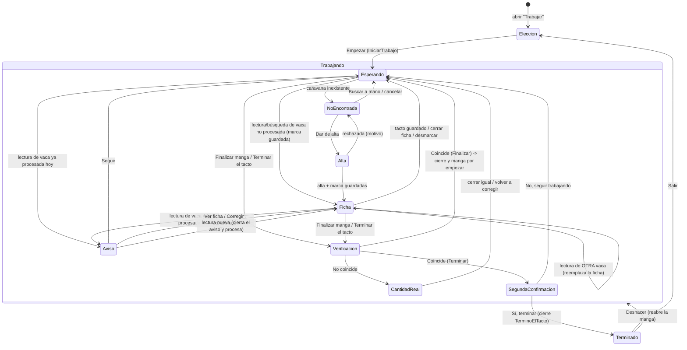

# Plan — 003 Flujo de tacto (núcleo del trabajo de campo)

> **Nota (2026-11-21):** este documento es el diseño y el plan **originales** (2026-11-16/17). Después de probar en una tablet real la spec cambió (se retiró el alta en campo; la ficha pasó a "elegir evento y Entrar"; CVET; mangas opcionales; movimientos con Editar; interfaz en vertical). **Lo vigente está en `spec.md`, sección "Ajustes tras las pruebas en la tablet" (RF-39 a RF-52).** Si algo de acá contradice esa sección, manda la spec.

Spec: [spec.md](spec.md) (aprobada). La spec hermana `specs/004-en-espera-y-rechazo` (borrador, depende de esta) **no se planifica acá**: solo se deja el diseño listo para que la sume (orden de guardado compartido, "último registro vigente" por consulta única, historial extensible).

## Resumen
Se agregan tres tablas de solo-agregar (**Manga**, **CierreManga**, **MarcaPasada**) y una migración que además amplía las acciones del historial y hace único el nombre de los veterinarios. La lógica de campo vive en servicios de `Infrastructure` (una transacción por operación, como los de la spec 001) detrás de **una sola fachada** `ICampoService` en `Application`, que es la que usan los ViewModels y la única que prueban los tests de integración. Las reglas puras (validación de la marca, reapertura de un cierre, día local, fechas del Excel, armado de la ficha, clasificación del aviso) son funciones sin base de datos y se prueban aparte. El lector entra por `IRfidReader` (en `Application`, implementación `FakeRfidReader` en `Aviss.Rfid`); los ViewModels no tocan MAUI y se prueban con xUnit enlazados desde `Aviss.Application.Tests`, como en la spec 002. Pantallas: `TrabajoPage` (la de campo), `EleccionTrabajoPage` y la lista de movimientos. Sin paquetes nuevos.

## Base de datos

### Entidades nuevas (Domain, `EntidadEditable` solo donde hay marca de anulado)
| Entidad | Columnas | Notas |
|---|---|---|
| `Manga : Entidad` | `RodeoId`, `Numero` (int ≥ 1), `AbiertaPorUsuarioId`, `DispositivoId`; `CreadoEnUtc` = apertura | Nunca cambia. Se crea en la misma transacción que la primera marca (RF-4). |
| `CierreManga : EntidadEditable` | `MangaId`, `Tipo` (`TipoCierreManga`: `Manual`, `TerminoElTacto`, `Automatico`), `FechaHoraUtc`, `CantidadAviss`, `CantidadConfirmada?`, `Diferencia?` (= confirmada − Aviss; vacía en el automático), `UsuarioId`, `DispositivoId`, `Anulado` | "Abierta/cerrada" de una manga se deduce: está cerrada si tiene un cierre con `Anulado = 0`. |
| `MarcaPasada : EntidadEditable` | `AnimalId`, `MangaId`, `FechaHoraUtc`, `OrdenInsercion` (long, **orden compartido**), `UsuarioId`, `DispositivoId`, `Anulado` | Una marca vigente por vaca y manga. |

Enums: `TipoCierreManga` (nuevo) y cinco valores nuevos en `AccionHistorial`: `MarcaPasada`, `AnulacionMarca`, `MangaAbierta`, `MangaCerrada`, `AnulacionCierre` (la "alta con marca" es `Alta` + `MarcaPasada` en la misma operación). Quién y cuándo anuló algo queda en el registro de historial de la anulación, no en columnas de la entidad (la entidad solo guarda `Anulado` y `ActualizadoEnUtc`, igual que `Tacto`).

### Migración `Mangas` (`dotnet ef migrations add Mangas -p src/Aviss.Infrastructure -s src/Aviss.Infrastructure`)
EF genera la parte de tablas, índices, CHECK y FK desde las configuraciones; lo que EF no sabe expresar va **a mano** en la migración (como en `Inicial`):

1. **`Manga`**: FK a `Rodeo` y a `Usuario` (`Restrict`); índice único `(RodeoId, Numero)`; `CHECK Numero >= 1`. Triggers `TR_Manga_NoModificar` (todo `UPDATE` aborta) y `TR_Manga_NoBorrar`.
2. **`CierreManga`**: FK a `Manga` y `Usuario`; `CHECK Tipo IN ('Manual','TerminoElTacto','Automatico')`, `CHECK CantidadAviss >= 0`, `CHECK CantidadConfirmada IS NULL OR CantidadConfirmada >= 0`, `CHECK Anulado IN (0,1)`; **índice único parcial `(MangaId) WHERE Anulado = 0`** (una manga no puede tener dos cierres vigentes). Trigger `TR_CierreManga_NoModificar` (solo permite `Anulado` 0→1 con las demás columnas iguales, igual que `TR_Tacto_NoModificar`) y `TR_CierreManga_NoBorrar`.
3. **`MarcaPasada`**: FK a `Animal`, `Manga` y `Usuario`; índice único `(OrdenInsercion)`; **índice único parcial `(MangaId, AnimalId) WHERE Anulado = 0`** (la base garantiza "vacas distintas" del contador, RF-5); índice `(AnimalId, FechaHoraUtc, OrdenInsercion)` para el "último vigente"; índice `(FechaHoraUtc)` para el avance del día; `CHECK Anulado IN (0,1)`. Triggers `TR_MarcaPasada_NoModificar` (solo `Anulado` 0→1), `TR_MarcaPasada_NoBorrar` y **`TR_MarcaPasada_MismoRodeo`** (`BEFORE INSERT`: aborta si el rodeo del animal no es el de la manga; la base, no solo la app, impide marcar una vaca en la manga de otro rodeo).
4. **`Historial`**: el `CHECK CK_Historial_Accion` se reescribe con las cinco acciones nuevas. SQLite no cambia un CHECK en el lugar: EF **reconstruye la tabla** y eso **borra sus triggers**. Por eso la migración termina con `DROP TRIGGER IF EXISTS` + `CREATE TRIGGER` de `TR_Historial_NoModificar` y `TR_Historial_NoBorrar` (texto literal copiado de `Inicial`, no compartido). `Historial` no es referenciada por ninguna FK, así que la reconstrucción es segura con `foreign_keys = ON`.
5. **`Usuario`**: índice único por expresión, a mano: `CREATE UNIQUE INDEX IX_Usuario_NombreClave ON Usuario (<ClaveSql de trim(Nombre)>)` (misma regla que `Caravana.CalcularClave`, RF-1; garantiza la unicidad también en la base). Antes, un `UPDATE` agrega `' (' || rowid || ')'` al nombre de los duplicados que existan (hoy solo está "Sin asignar", pero una base de desarrollo con duplicados no debe romper la actualización). No se usa columna generada porque agregarla reconstruiría `Usuario` (con FK entrantes) y borraría sus triggers.
6. `Down`: borra triggers, índice y tablas nuevas; **no** deshace el CHECK de `Historial` (aborta si hay acciones nuevas; se documenta en el código).

Verificaciones de la migración (tarea 1): `dotnet ef migrations has-pending-model-changes` limpio; un test que crea la base con solo `Inicial`, carga datos (animal, tacto, historial, dos usuarios con el mismo nombre), aplica `Mangas` y comprueba que los datos siguen, que los triggers de `Historial`, `Tacto`, `Animal` y `Usuario` siguen existiendo, y que el historial acepta las acciones nuevas. Esto cierra el riesgo de la spec 001 "aplicar una segunda migración sobre una base con datos".

### Orden de guardado compartido (RF-21)
No se agrega tabla de secuencia: `SiguienteOrdenAsync` = máximo de `OrdenInsercion` entre `Tacto` y `MarcaPasada` más uno, calculado **dentro de la transacción** de cada operación (cada una indexada por ese campo). Cada tabla conserva su índice único; entre tablas lo garantiza el cálculo dentro de la transacción (SQLite admite un solo escritor). La spec 004 suma sus tablas al mismo cálculo. `TactoRepository.SiguienteOrdenInsercionAsync` pasa a usar este cálculo y `TrabajoCampoService` deja de calcular el suyo.

## Capas y servicios

### Domain (puro, sin base de datos)
| Qué se agrega | RF |
|---|---|
| `Manga.Abrir(...)`, `CierreManga.Cerrar(...)` y `MarcarAnulado`, `MarcaPasada.Registrar(...)` y `MarcarAnulada`; enum `TipoCierreManga`; acciones de historial nuevas | RF-4 a RF-9, RF-12, RF-20, RF-38 |
| `ReglasMarcaPasada.Validar(DatosValidacionMarca)` → `MotivoRechazoMarca?` (`AnimalAnulado`, `RodeoDeBaja`, `EstablecimientoDeBaja`, `FechaFutura`, `FechaAnteriorAlUltimoRegistro`); mismas tolerancias que `ReglasTacto` (5 min) | RF-21 |
| `ReglasManga.MotivoParaNoReabrir(DatosReapertura)` (es el último cierre vigente del rodeo, no es automático, es de hoy, no hay otra manga abierta, no está anulado) | RF-9 |
| `DiaLocal.RangoUtcDeHoy(ahoraUtc, TimeZoneInfo)` → `[desde, hasta)` UTC (maneja días de 23/25 h y medianoches que no existen) y `DiaLocal.EsDeDiaAnterior` | RF-10, RF-30 |
| `ReglasAltaCampo.IdElectronicoDeLectura(caravanaTipeada, codigoLeido)` → (id o nulo, omitido por formato) | RF-25 |
| `FechaExcel.TryParsear(texto, out DateOnly)`: día/mes/año con "/", espacios de más, año de 2 cifras = 20aa, día/mes imposible = falla | RF-14 |

### Application
| Qué se agrega | RF |
|---|---|
| **Puertos** (`Puertos/PuertosCampo.cs`): `IRfidReader` (`Lecturas(ct)` como `IAsyncEnumerable<TagRead>`, `EstadoConexionRfid`, `ConectarAsync`, `DesconectarAsync`), `TagRead(Codigo, FechaHoraUtc)`, `ISimuladorLecturas` (`Emitir(codigo)`), `IZonaHoraria` (`TimeZoneInfo Zona`), `IPreferenciasDispositivo` (veterinario recordado), `IAvisosCampo` (`Confirmacion()`, `Repetido()`: vibración y sonido), `IPantalla` (mantener encendida), `ITemporizador` (`EsperarAsync(TimeSpan, ct)`) | RF-1, RF-3, RF-22, RF-27, RF-31 |
| **Repositorios (puertos)**: `IMangaRepository`, `IMarcaPasadaRepository`, `IRegistroCampoRepository` (último registro vigente de una vaca entre tacto y marca, `SiguienteOrdenAsync`, movimientos, procesadas hoy); `IUsuarioRepository.ExisteNombreAsync`; `IAnimalRepository.TieneMarcasVigentesAsync` | RF-1, RF-5, RF-21, RF-28, RF-30 |
| **`ICampoService`** (fachada **singleton** que abre un scope por operación, igual que `ImportacionService` de la spec 002; ver Decisiones): `IniciarTrabajoAsync`, `ObtenerEstadoTrabajoAsync`, `ProcesarLecturaAsync`, `ObtenerFichaAsync`, `RegistrarTactoAsync`, `AltaEnCampoConMarcaAsync`, `DeshacerAsync` (tacto, marca, cierre o alta), `ObtenerResumenMangaAsync`, `FinalizarMangaAsync`, `TerminarElTactoAsync`, `ListarMovimientosAsync`, `ListarRodeosParaTrabajarAsync`, `ListarVeterinariosActivosAsync`, `CrearVeterinarioAsync`, `ListarEstadosActivosAsync`, `CaravanaDeMuestraAsync` (solo para el simulador) | todos |
| **Comandos y DTOs** (`Campo/`): `ProcesarLecturaCommand`, `AltaConMarcaCommand`, `FinalizarMangaCommand`, `TerminarElTactoCommand`, `DeshacerCommand`; `ResultadoLecturaDto` (`Marcada` / `YaPaso` / `Repetido` / `NoEncontrada`, ficha, último registro, manga), `FichaAnimalDto`, `EventoHistorialDto`, `EstadoTrabajoDto` (manga, contador, avance), `ResumenMangaDto`, `CierreMangaDto`, `AvanceRodeoDto`, `MovimientoDto` (con `PuedeDeshacer` y, en cierres, las dos cifras), `RodeoParaTrabajarDto` | RF-2 a RF-30 |
| **Puros**: `ConstructorFicha` (lee `DatosOriginalesJson` con tolerancia a faltante o JSON roto; arma los campos, `VINS`/`UTORO` aparte sin fecha, y el historial cronológico con días transcurridos, fechas ilegibles como texto, anulados marcados, sin marcas de pasada); `ReglasAviso.Clasificar(marcaVigenteDeHoy, mangaActual)` → `Repetido` / `YaPasoOtraManga` / `YaPasoSinManga` | RF-13, RF-14, RF-22 |
| `CodigoError` nuevos: `NoHayMangaAbierta`, `CantidadInvalida`, `MarcaYaAnulada`, `MarcaNoEsLaUltima`, `AnimalConMarcasVigentes`, `CierreYaAnulado`, `CierreNoEsElUltimo`, `CierreAutomaticoNoSeDeshace`, `CierreDeOtroDia`, `HayOtraMangaAbierta`; nombre de veterinario repetido usa el `Duplicado` existente. Un mensaje fijo en español por código, sin datos | RF-1, RF-9, RF-26, RF-33 |

### Infrastructure (todo `internal`, salvo lo que ya es público)
| Qué se agrega o cambia | RF |
|---|---|
| Configuraciones EF, `DbSet`s y migración `Mangas` (arriba); repositorios nuevos; `ZonaHorariaSistema` (`TimeZoneInfo.Local`); registro en `AddAvissInfrastructure` | RF-4 a RF-9, RF-20 |
| `MarcaPasadaService` (scoped): `ProcesarLectura` — busca la vaca (caravana primero, después identificador electrónico), calcula el rango de hoy, y en **una transacción**: si ya está procesada hoy no guarda nada y clasifica el aviso; si no, valida (`ReglasMarcaPasada`), obtiene o crea la manga, guarda marca + historial (+ manga + historial). `DeshacerMarca`: solo si es el último registro vigente de la vaca | RF-9 a RF-12, RF-20, RF-21, RF-22, RF-26, RF-38 |
| `MangaService` (scoped): `IniciarTrabajo` (cierra con `Automatico` la manga abierta de un día anterior), `ObtenerEstado`, `ObtenerResumen`, `Finalizar`, `Terminar` (cierra con `TerminoElTacto`; si no hay manga abierta no guarda nada), `Reabrir` (anula el cierre; `ReglasManga`) | RF-4 a RF-10, RF-38 |
| `AltaCampoService` (scoped): alta + marca (+ manga) en una transacción reutilizando el núcleo de `AnimalService.AltaEnCampoAsync`, que se extrae a un método que no abre transacción propia; `AnularAltaConMarca` (si solo tiene la marca del alta, anula marca y alta juntas) | RF-25, RF-29 |
| `ConsultaCampoService` (scoped): ficha, movimientos (50 más recientes, con `PuedeDeshacer`), avance (vacas no anuladas, procesadas hoy = marca o tacto normal vigente hoy), rodeos para trabajar, veterinarios, estados activos, caravana de muestra | RF-2, RF-13, RF-14, RF-28, RF-30 |
| `CampoService` (**singleton**): fachada de `ICampoService` que delega en los servicios scoped | todos |
| **Cambios en lo existente:** `TrabajoCampoService` valida contra el **último registro vigente** (tacto o marca) y calcula el orden con el cálculo compartido; `AnularTactoAsync` exige que el tacto sea el último registro vigente de **cualquier tipo**; `AnimalService.AnularAltaAsync` rechaza si hay marcas vigentes (`AnimalConMarcasVigentes`); `UsuarioService.CrearAsync` rechaza nombre repetido (`Duplicado`) | RF-1, RF-16, RF-21, RF-26 |

### Aviss.Rfid
`FakeRfidReader : IRfidReader, ISimuladorLecturas` (canal sin límite, `Emitir(codigo)`, `Lecturas` termina al cancelar; admite lecturas grabadas iniciales para tests) y `LectorNoDisponible : IRfidReader` (nunca emite; es lo que se registra fuera de `DEBUG` hasta la spec del bastón). | RF-31 |

## Pantallas

### ViewModels (App/ViewModels, sin tipos de MAUI; CommunityToolkit.Mvvm)
- `SesionTrabajo` (singleton): veterinario, rodeo y establecimiento elegidos (para pasarlos entre páginas).
- `EleccionTrabajoViewModel`: veterinarios activos con el recordado preseleccionado (`IPreferenciasDispositivo`), crear veterinario (nombre y matrícula; muestra el error de nombre repetido), establecimientos y rodeos con avance, "Empezar a trabajar" (guarda la preferencia, llena `SesionTrabajo`, navega).
- `TrabajoViewModel`: el corazón. Lee `IRfidReader.Lecturas`, serializa el procesamiento (una lectura por vez) y guarda **solo la última lectura pendiente** mientras hay un cuadro abierto (RF-19). Estados en el diagrama de abajo. Aviso de 5 s con `ITemporizador`. Refresca contador y avance cada 60 s y al volver de segundo plano (`RecalcularAsync`, llamado por la página): así cubre el cambio de día y la zona horaria sin cerrar mangas (RF-30, RF-10). Llama a `IAvisosCampo` y `IPantalla`.
- `MovimientosViewModel`: lista de últimos movimientos con deshacer.
- `InicioViewModel`: suma "Trabajar" (navega a la elección).
- `INavegacion` suma `IrAEleccionTrabajoAsync()`, `IrATrabajoAsync()` y `IrAMovimientosAsync()`.

### Páginas (tablet, horizontal; botones de alto 72 o más, texto 24 o más, alto contraste; constitución §9)
- **`EleccionTrabajoPage`:** veterinario (lista grande con el recordado marcado, "Crear veterinario"), establecimiento y rodeo con avance, botón "Empezar".
- **`TrabajoPage`:** arriba rodeo, veterinario (tocable para cambiarlo), "Manga N" con el contador grande, avance del día con la fecha, y los botones "Finalizar manga" y "Terminar el tacto". Centro: la ficha (caravana enorme, estado actual, último tacto, columnas del Excel, `VINS`/`UTORO` aparte), los botones de estado en un `FlexLayout` con salto de línea (el actual resaltado) y el historial cronológico a un costado sin tapar los botones. Abajo: búsqueda manual (teclado numérico) y "Últimos movimientos". Encima, como capas (no `DisplayAlert`, para controlar las lecturas que llegan): aviso "Animal repetido / Ya pasó", "Caravana no encontrada", alta en campo, cantidad real, verificación de "Finalizar manga" / "Terminar el tacto", segunda confirmación, resumen de "Terminar el tacto" con "Deshacer", y el aviso de 5 s con "Deshacer". Panel del simulador (existente, inexistente, ya leída) **solo con `#if DEBUG`**.
- **`MovimientosPage`:** los 50 movimientos con "Deshacer" en los que corresponda; los cierres muestran "Al cerrar: N · Hoy: M" si difieren.

### Diagrama de estados de la pantalla de trabajo

Reglas de lectura por estado (RF-17, RF-19, RF-22b): en **Esperando** y **Ficha** se procesa de inmediato; en **Aviso** se cierra el aviso y se procesa; en un **cuadro que pide datos** (Alta, CantidadReal, Verificacion, SegundaConfirmacion, confirmación de Corregir) se guarda solo la última lectura y se procesa al cerrarlo; la misma vaca de la ficha abierta se ignora. El aviso de 5 s y el aviso de deshacer son capas independientes que no cambian el estado.

## Archivos
- **Crear (Domain):** `Entidades/{Manga,CierreManga,MarcaPasada}.cs`; `Reglas/{ReglasMarcaPasada,ReglasManga,DiaLocal,ReglasAltaCampo,FechaExcel}.cs`.
- **Crear (Application):** `Puertos/PuertosCampo.cs`; `Campo/{ComandosCampo,DtosCampo,ConstructorFicha,ReglasAviso}.cs`.
- **Crear (Infrastructure):** `Servicios/{MarcaPasadaService,MangaService,AltaCampoService,ConsultaCampoService,CampoService}.cs`; `Sistema/ZonaHorariaSistema.cs`; `Migrations/*_Mangas.cs`.
- **Crear (Rfid):** `FakeRfidReader.cs`, `LectorNoDisponible.cs`.
- **Crear (App):** `ViewModels/{SesionTrabajo,EleccionTrabajoViewModel,TrabajoViewModel,MovimientosViewModel,EstadosTrabajo,ColaDeLecturas}.cs`; `Paginas/{EleccionTrabajoPage,TrabajoPage,MovimientosPage}.xaml(.cs)`; `Servicios/{PreferenciasMaui,PantallaMaui,TemporizadorReal}.cs`; `Platforms/Android/AvisosAndroid.cs`.
- **Crear (tests):** ver "Estrategia de tests".
- **Modificar:** `Domain/Enums/Enums.cs`; `Application/Comun/Resultado.cs` (códigos), `Puertos/Puertos.cs`, `Servicios/Servicios.cs`; `Infrastructure/Persistencia/{AvissDbContext,Configuraciones/Configuraciones.cs}`, `Repositorios/Repositorios.cs`, `Servicios/{TrabajoCampoService,AnimalService,Ayudas,EstructuraServices}.cs`, `DependencyInjection.cs`; `App/MauiProgram.cs`, `AppShell.xaml(.cs)`, `ViewModels/{INavegacion,InicioViewModel}.cs`, `Paginas/InicioPage.xaml`, `Servicios/NavegacionShell.cs`, `Platforms/Android/AndroidManifest.xml` (permiso `VIBRATE`); `tests/Aviss.Excel.Tests/GeneradorMuestras.cs` y `tests/muestras/*` (`VINS` pasa a número entero); `docs/requerimientos.md`, `docs/plan.md`, `docs/arquitectura.md`, `MEMORY.md`.

## Decisiones
- **Una fachada `ICampoService` singleton con scope por operación** — elegida porque los ViewModels son transitorios y se resuelven desde la raíz: si recibieran servicios `scoped` (DbContext, `UnitOfWork`) compartirían un único contexto durante toda la vida de la app (no es seguro para hilos y acumula entidades). Es el mismo patrón que ya usa `ImportacionService`, y una sola interfaz es fácil de falsear en los tests de los ViewModels. Alternativa descartada: inyectar los servicios `scoped` en los ViewModels, por lo dicho; descartada también una `IServiceScopeFactory` en cada ViewModel, porque mezcla infraestructura con la lógica de pantalla.
- **Cierre de manga con anulación (tabla aparte), no una columna de cierre en `Manga`** — elegida porque mantiene "solo agregar": la manga nunca cambia, el cierre se deshace marcándolo anulado (`Anulado` 0→1, como `Tacto`) y un índice único parcial garantiza un solo cierre vigente por manga. Costo: una tabla más con su trigger y su test, dentro de la tarea 1. Alternativa descartada: guardar `CerradaEnUtc` en la manga y permitir reabrirla (violaría el trigger de inmutabilidad y la constitución §3).
- **La manga se crea con la primera marca** — elegida porque así "no hay otra manga abierta" equivale a "nadie marcó en la siguiente" (regla simple de RF-9) y no quedan mangas vacías imposibles de borrar. Alternativa descartada: abrir la siguiente al cerrar, que obligaría a descartar mangas vacías.
- **Orden de guardado compartido por cálculo de máximo en la transacción** — elegida porque no agrega tabla ni migración extra y la spec 004 solo suma otra tabla al cálculo. Alternativa descartada: tabla de secuencia de una fila, que agrega una escritura por registro y un punto único de fallo.
- **El "último registro vigente" es una consulta única entre tacto y marca** (`IRegistroCampoRepository`), usada por la validación de reloj, el deshacer, el aviso y la lista. Alternativa descartada: reglas separadas por tipo en cada servicio, que se desincronizan al llegar la spec 004.
- **`procesada hoy` = marca vigente o tacto normal vigente con fecha en el día local** — así una vaca con un tacto de hoy y sin marca (datos de la spec 001) cuenta, y el aviso dice "sin manga registrada" (RF-22). El rango del día se calcula en C# con `TimeZoneInfo` (`DiaLocal`) en cada consulta y se pasa en UTC; las fechas se guardan como texto de ancho fijo que ordena bien, así que la comparación por rango es válida en SQLite. No se guarda ningún "día".
- **Reapertura de cierre y deshacer por reglas puras** (`ReglasManga`, `ReglasMarcaPasada`) — el servicio lee, arma los datos y aplica la regla; así cada regla de RF-9 y RF-21 se prueba sin base de datos.
- **`IRfidReader` en `Application`; `FakeRfidReader` en `Aviss.Rfid`; simulador solo en `DEBUG`** — elegida porque `Application` define los puertos (constitución §5) y `Aviss.Rfid` ya depende de `Application`. En compilación de distribución se registra `LectorNoDisponible` y el panel del simulador y su registro quedan dentro de `#if DEBUG` (RF-31 se verifica por revisión de la configuración). Alternativa descartada: dejar el simulador siempre registrado y ocultar el panel con una bandera, porque no cumple "no disponible en la versión que se distribuye".
- **Veterinario recordado en `IPreferenciasDispositivo` (almacén de preferencias de MAUI), no en la base** — elegida por la misma razón que el identificador del dispositivo (spec 001 RF-23): no debe cambiar al restaurar o recrear la base. Sin dependencia nueva (las preferencias, la vibración y la pantalla encendida son de MAUI Essentials, que ya viene con `Microsoft.Maui.Controls`).
- **Sonido y vibración por `IAvisosCampo`, implementación en `Platforms/Android`** (`Vibrator` y `ToneGenerator`): sin voz y sin paquete nuevo; la implementación necesita el permiso normal `VIBRATE` (no pide confirmación al usuario). Alternativa descartada: paquete de audio de terceros, por la constitución §10.
- **Capas encima del contenido en vez de `DisplayAlert`** — elegida porque los diálogos modales de MAUI no dejan al ViewModel decidir qué hacer con las lecturas que llegan (RF-19) ni se pueden probar con xUnit; con un estado `CuadroActivo` en el ViewModel todo es testeable.
- **Refresco cada 60 s y al volver de segundo plano**, en lugar de un disparador exacto a medianoche — elegida porque la consulta es barata, cubre cambios de hora y de zona, y evita lógica de temporizadores precisos. La manga nunca se cierra por esto (RF-10).
- **Índice único por expresión para el nombre de veterinario** (a mano) y no columna generada: ver "Base de datos".
- **Sin dependencias nuevas.** Todo lo nuevo usa lo que ya está (EF Core, CommunityToolkit.Mvvm, MAUI Essentials, la API de Android).

## Estrategia de tests
Tests primero en cada tarea. Los de integración usan `EscenarioConServicios` con la base real migrada y `FakeReloj` (ampliado con un `FakeZonaHoraria` y un `FakeTemporizador`) y entran por `ICampoService`.

| RF | Test (proyecto › clase › caso) |
|---|---|
| RF-1 | Infrastructure.Tests › `UsuarioNombreUnicoTests` (repetido con otras mayúsculas/espacios, contra baja, contra "Sin asignar", índice en la base); Application.Tests › `EleccionTrabajoViewModelTests` (preselección, baja, no ofrece "Sin asignar", sin veterinario no empieza) |
| RF-2 | Infrastructure.Tests › `ConsultasCampoTests` (rodeos activos, Exportado incluido, de baja excluido, avance); `EleccionTrabajoViewModelTests` |
| RF-3, RF-34, RF-36 | A verificar en el emulador; `TrabajoViewModelTests` (el estado se conserva) |
| RF-4, RF-5 | Domain.Tests › `MangaTests`; Infrastructure.Tests › `MangaServiceTests` (manga por empezar, se abre con la primera marca, contador, releer no suma, desmarcar resta) y `EsquemaMangasTests` (un vigente por vaca y manga; número único por rodeo) |
| RF-6 | `MangaServiceTests` (Coincide; No coincide; cierre con diferencia; sin manga abierta; la siguiente queda por empezar; el avance no cambia) |
| RF-7 | `MangaServiceTests` (Terminar con manga y sin manga; cierre `TerminoElTacto`); `TrabajoViewModelTests` (doble confirmación en orden, "No, seguir", app cerrada entre confirmaciones no guarda) |
| RF-8 | `EsquemaMangasTests` (triggers de `Manga` y `CierreManga`: no modificar, no borrar, solo `Anulado` 0→1, no vuelve a 0; un cierre vigente por manga); `MangaServiceTests` (cifras al desmarcar en manga cerrada); `MovimientosViewModelTests` (muestra ambas cifras) |
| RF-9 | Domain.Tests › `ReglasMangaTests`; `MangaServiceTests` (reabrir feliz; no es el último; automático; de otro día; hay otra manga abierta; ya anulado) |
| RF-10 | `MangaServiceTests` (cierre automático de día anterior; sin corte a medianoche con la manga abierta; corte de energía deja la manga abierta); Domain.Tests › `DiaLocalTests` |
| RF-11, RF-12 | `MarcaPasadaServiceTests` (caravana antes que identificador, de otro rodeo, doble coincidencia, marca + manga + historial atómicos, rechazo por reloj no guarda nada, falla forzada a mitad no deja nada) |
| RF-13, RF-14 | Application.Tests › `ConstructorFichaTests` (JSON roto o ausente, alta sin originales, `VINS` sin fecha, orden cronológico, "hace N días", anulados marcados, sin marcas); Domain.Tests › `FechaExcelTests`; Excel.Tests › `FechasMuestraTests` (todas las fechas de la muestra de 226 vacas se interpretan) |
| RF-15, RF-16, RF-18 | `TrabajoViewModelTests` (un toque guarda; sin estados activos; rechazo deja la ficha abierta); Infrastructure.Tests › `RegistrarTactoConMarcaTests` (la validación mira el último registro, tacto después de la marca) |
| RF-17 | `TrabajoViewModelTests` (resumen y listo para la siguiente) |
| RF-19 | `TrabajoViewModelTests` + `ColaDeLecturasTests` (reemplazo de ficha, misma vaca ignorada, cuadro abierto guarda solo la última, se procesa al cerrar) |
| RF-20 | `EsquemaMangasTests` (trigger de `MarcaPasada`, FK, trigger de mismo rodeo, índices); `MarcaPasadaServiceTests` |
| RF-21 | Domain.Tests › `ReglasMarcaPasadaTests`; Infrastructure.Tests › `OrdenCompartidoTests` (mismo instante, gana el guardado después sin importar el tipo) |
| RF-22 | Application.Tests › `ReglasAvisoTests` (repetido, otra manga, sin manga); `MarcaPasadaServiceTests` (tacto de hoy sin marca = "sin manga registrada"); `TrabajoViewModelTests` (Ver ficha, Seguir, Corregir con confirmación y sin ofrecerlo si lo último es la marca; lectura nueva cierra el aviso) |
| RF-23, RF-24 | `MarcaPasadaServiceTests` (la búsqueda manual marca igual); `TrabajoViewModelTests` (inexistente ofrece alta o búsqueda y no guarda) |
| RF-25 | Domain.Tests › `ReglasAltaCampoTests`; Infrastructure.Tests › `AltaConMarcaTests` (identificador solo si difiere, repetidos, código ilegible como identificador, desde "Buscar a mano", sin estado, alta + marca + manga atómicos) |
| RF-26, RF-27 | `DeshacerTests` (tacto, marca; no es el último; anulación no se deshace; desmarcar vuelve a pendiente); `TrabajoViewModelTests` (aviso de 5 s con `FakeTemporizador`, reemplazo, sobrevive a una lectura, rechazo si ya no se puede) |
| RF-28 | `ConsultasCampoTests` (50 más recientes, tipos, anulados, `PuedeDeshacer`); `MovimientosViewModelTests` |
| RF-29 | `AltaConMarcaTests` (anular alta con solo su marca, con otros registros, importado) |
| RF-30 | `ConsultasCampoTests` (procesadas hoy con marca y con tacto, ayer no, rodeo vacío, cambio de zona); `DiaLocalTests`; `TrabajoViewModelTests` (refresco periódico y al volver) |
| RF-31 | Rfid.Tests › `FakeRfidReaderTests` (lecturas grabadas, emitir, cancelar); `TrabajoViewModelTests` con un lector falso; revisión: el simulador solo en `#if DEBUG` |
| RF-32, RF-33 | Application.Tests › `MensajesCampoTests` (todos los códigos tienen mensaje en español sin datos); revisión de código y de configuración (sin permisos ni dependencias de red) |
| RF-35 | `MangaServiceTests` y `MarcaPasadaServiceTests` (falla forzada a mitad no deja nada; manga abierta intacta al reabrir) |
| RF-37 | Infrastructure.Tests › `RendimientoCampoTests` (`Categoria=Rendimiento`: 20.000 vacas y 100.000 registros; búsqueda con ficha < 300 ms, marca o tacto < 300 ms, avance y contador < 200 ms) |
| RF-38 | `HistorialCampoTests` (cada acción con veterinario y fecha; historial nuevo inmutable en la base) |
| Esquema | `MigracionMangasTests` (actualización desde `Inicial` con datos conserva todo y los triggers); `dotnet ef migrations has-pending-model-changes` limpio |

## Tabla RF → parte del plan
| RF | Parte del plan |
|---|---|
| RF-1 | `UsuarioService`/índice de nombre (T1, T2); `IPreferenciasDispositivo`, `EleccionTrabajoViewModel`/página (T3, T5) |
| RF-2 | `ConsultaCampoService` (T2); `EleccionTrabajoViewModel`/página (T3, T5) |
| RF-3 | `TrabajoViewModel`, `IPantalla`, `TrabajoPage` (T3, T4, T5) |
| RF-4 a RF-10 | Entidades y migración (T1); `MangaService`, `MarcaPasadaService` (T2); `TrabajoViewModel` y capas de cierre (T3, T5) |
| RF-11, RF-12 | `MarcaPasadaService` (T2); `TrabajoViewModel` (T3) |
| RF-13, RF-14 | `FechaExcel` (T1); `ConstructorFicha`, `ConsultaCampoService` (T2); ficha en `TrabajoPage` (T4) |
| RF-15 a RF-19 | `TrabajoCampoService` ajustado (T2); `TrabajoViewModel`, `ColaDeLecturas` (T3); `TrabajoPage` (T4) |
| RF-20, RF-21 | Entidades, reglas y migración (T1); orden compartido y validación (T2) |
| RF-22 | `ReglasAviso`, `MarcaPasadaService` (T2); `TrabajoViewModel` (T3); capa de aviso (T4) |
| RF-23 a RF-25 | `MarcaPasadaService`, `AltaCampoService` (T2); `TrabajoViewModel` (T3); búsqueda, no encontrada y alta en `TrabajoPage` (T4) |
| RF-26 a RF-29 | `MarcaPasadaService`, `MangaService`, `AltaCampoService`, `ConsultaCampoService` (T2); `TrabajoViewModel`, `MovimientosViewModel` (T3); aviso de 5 s (T4); `MovimientosPage` (T5) |
| RF-30 | `ConsultaCampoService`, `DiaLocal` (T1, T2); refresco en `TrabajoViewModel` (T3) |
| RF-31 | `IRfidReader`, `FakeRfidReader`, registro en `DEBUG` (T3); panel del simulador (T4) |
| RF-32, RF-33 | Revisión en T2, T3 y T5; `MensajesCampoTests` (T2) |
| RF-34, RF-36 | `TrabajoPage` y páginas (T4, T5), verificación en el emulador |
| RF-35 | Transacciones de T2; manga abierta persistida (T1) |
| RF-37 | `RendimientoCampoTests` (T2) |
| RF-38 | `HistorialCampoTests` y migración (T1, T2) |

## Riesgos
- **Reconstrucción de `Historial` al cambiar su CHECK:** SQLite borra sus triggers. Se recrean a mano al final de la migración y un test de actualización desde `Inicial` con datos lo comprueba. Si el script que genera EF toca otra tabla (por ejemplo `Usuario`), también hay que recrear sus triggers: revisar el script generado antes de seguir.
- **Índice por expresión de `Usuario` fuera del modelo de EF:** si una migración futura reconstruye `Usuario`, el índice se pierde. Queda anotado en la migración y cubierto por el test de unicidad en la base.
- **Orden compartido sin restricción entre tablas:** lo garantiza el cálculo dentro de la transacción (un solo escritor en SQLite). El test `OrdenCompartidoTests` lo comprueba con operaciones seguidas; dos escrituras concurrentes se evitan porque el ViewModel serializa las operaciones.
- **Concurrencia de lecturas en el ViewModel:** una lectura que llega mientras se guarda otra no debe correr en paralelo (dos transacciones en el mismo archivo). `ColaDeLecturas` serializa y conserva solo la última pendiente; cubierto por tests.
- **Día local y zona horaria:** el rango del día depende de la zona del dispositivo; una zona con horario de verano a medianoche puede no tener las 0:00. `DiaLocal` lo resuelve y se prueba con una zona personalizada con regla de horario de verano; en Android real se verifica en el emulador cambiando la zona.
- **Rendimiento del avance con 100.000 registros:** la consulta usa índices por fecha en `MarcaPasada`; en `Tacto` no hay índice por fecha sola. Si `RendimientoCampoTests` supera 200 ms se agrega un índice en una migración chica dentro de esta misma spec antes de cerrar.
- **Sonido, vibración y voz en el emulador:** `ToneGenerator` y `Vibrator` pueden comportarse distinto en el emulador y en la tablet. Se verifica ahí; sin permiso `VIBRATE` no vibra (se agrega al manifiesto).
- **Botón Atrás de Android durante el trabajo:** sale de la pantalla sin "Terminar el tacto"; la manga queda abierta y se retoma (RF-10). A revisar con el uso real si conviene confirmar la salida.
- **Tamaño de la tarea 2:** es la más grande (cinco servicios y la fachada). Se divide por dentro en bloques con tests propios (marca y lectura, mangas, alta, consultas); si no cabe, lo primero en recortar es `MovimientosViewModel` y la lista de movimientos (RF-28), dejando solo el aviso de 5 s.
- **`GeneradorMuestras.cs` llena `VINS` con una fecha:** en el Excel real es un número. Se corrige en la tarea 5 y se regeneran las muestras; los tests de la spec 002 que dependan de ese valor se ajustan.
- **Pendiente de documentación (no de código):** al aprobarse la spec 004, la exportación pasa a 005 y el bastón a 006; `docs/plan.md` se edita en la tarea 5 con la partición 003 + 004 y el aviso de renumeración.
