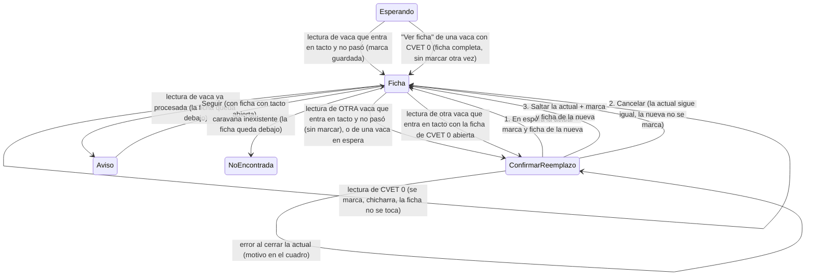

# Plan — 009 Lectura de otra vaca con una ficha abierta

Spec: [spec.md](spec.md) (aprobada; ajustada el 2026-11-24 con RF-15: la ficha de CVET 0 es completa y cuenta como ficha con tacto abierta)

## Resumen
El servicio de lectura aprende a **decir si marcaría a una vaca sin marcarla** (un pedido con la bandera "hay una ficha con tacto abierta" devuelve `RequiereDecision` sin guardar nada). El `TrabajoViewModel` usa esa respuesta para abrir un cuadro nuevo con las tres opciones; las opciones 1 y 3 reutilizan "poner en espera" y "saltear" que ya existen y recién después piden la marca de verdad (el mismo pedido, sin la bandera). **Sin migración ni tablas nuevas** (RF-13).

## Base de datos
Ninguna. No hay entidades, migración, triggers ni SQL a mano: "Cancelar la lectura" no guarda nada y las opciones 1 y 3 usan las acciones de historial existentes (`EsperaCreada`, `EsperaSalteada`, marca de pasada creada). `dotnet ef migrations has-pending-model-changes` debe seguir limpio.

## Capas y servicios
| Capa | Qué se agrega | RF |
|---|---|---|
| Application | `ProcesarLecturaCommand(RodeoId, Codigo, bool HayFichaConTactoAbierta = false)`: el valor por omisión mantiene todo lo de hoy y los tests existentes compilan sin tocar. | RF-1, RF-8 |
| Application | `TipoResultadoLectura.RequiereDecision`: la vaca se encontró, entra en tacto, no está procesada hoy, pasó la validación y **no se guardó nada**. El `ResultadoLecturaDto` trae `Caravana` y la `Ficha` (para el CVET del aviso); `MarcaId`, `NumeroManga` y `ContadorManga` van nulos. | RF-1, RF-2 |
| Infrastructure | `MarcaPasadaService.ProcesarLecturaAsync`: con la bandera, después de **toda** la validación actual (rodeo, búsqueda, espera, "procesada hoy", reloj y baja) y del chequeo de CVET, si la vaca se marcaría y entra en tacto devuelve `RequiereDecision` **sin llamar al `Marcador`** y sin historial. Todo lo demás (no encontrada, en espera, repetido o ya pasó, CVET 0 que se marca, errores de reloj) sale igual que hoy. Una sola transacción de lectura. `CampoService` solo reenvía el comando. | RF-1, RF-6, RF-8, RF-10, RF-13 |
| Application (puertos) | Sin puertos nuevos. El aviso reutiliza `IAvisosCampo.Repetido()` (sonido o vibración de atención) para RF-2; si en la tablet no alcanza, se ajusta aparte. | RF-2 |
| App (ViewModel) | Ver "Pantallas". | RF-1 a RF-12 |

## Pantallas
**ViewModel** (`TrabajoViewModel`, archivo parcial nuevo `TrabajoViewModel.Reemplazo.cs` para no engordar los otros):
- `CuadroTrabajo.ConfirmarReemplazo` (nuevo) en `Bloquea`: la cola de lecturas conserva solo la última (RF-9).
- Qué hay en pantalla para el aviso: `ReemplazoCaravanaActual`, `ReemplazoCaravanaNueva` (con CVET), `HayConfirmarReemplazo`, `HayReemplazoConEventoSinGuardar` y su texto (RF-2), y `MensajeCuadro` para los errores (RF-10).
- `ProcesarLecturaAsync`: calcula `HayFichaConTactoAbierta = Etapa == Ficha` (cualquier ficha abierta, **incluida** la de CVET 0 abierta con "Ver ficha"; ya no se filtra por `EntraEnTacto`) y lo manda en el comando. En `AplicarLecturaAsync`:
  - `RequiereDecision`: guarda la lectura pendiente (`_reemplazoPendiente`: el resultado y el código), suena `Repetido()` y abre el cuadro.
  - `EnEspera`: si hay ficha con tacto abierta y es otra vaca, abre el mismo cuadro con la ficha ya cargada (RF-6); si no, como hoy.
  - `SinTacto`: si hay ficha con tacto abierta, **no** llama a `CerrarFichaInterno()` (RF-8.2).
  - `Repetido`/`YaPaso`: igual que hoy (aviso RF-22 sobre la ficha).
- `SeguirAsync` (en `TrabajoViewModel.Avisos.cs`): si hay una ficha con tacto abierta, solo cierra el aviso (RF-8.4).
- Tres comandos: `PonerEnEsperaYAbrirNuevaCommand`, `CancelarLecturaCommand`, `SaltarYAbrirNuevaCommand`. Los dos de abrir comparten un método interno:
  1. Si no hay cuadro `ConfirmarReemplazo`, no hace nada.
  2. **Cierra la actual:** opción 1 → `PonerEnEsperaAsync` (se saca de `PonerEnEsperaCommand` a un método interno que devuelve el `Resultado`, así lo comparten); si la actual `EnEspera`, no hace nada (queda pendiente, RF-7). Opción 3 → `SaltearEsperaAsync` solo si la actual `EnEspera`; si no, nada (RF-7). Si falla: `MensajeCuadro` con el motivo, el cuadro sigue abierto y no se toca nada más (RF-10). Un `VacaYaEnEspera` (ficha vieja) se toma como éxito.
  3. **Abre la nueva:** si el pendiente era `RequiereDecision`, repite `ProcesarLecturaAsync` **sin la bandera** (marca de verdad) y aplica el resultado con `AplicarLecturaAsync` (que ya sabe de contador, cierre automático de la manga y ficha). Si el pendiente era `EnEspera`, abre su ficha sin marcar. Si la marca se rechaza: se cierra la ficha actual (ya salió de la pantalla), `MensajeError` con el motivo y no se abre nada (RF-10).
  4. **Recién al final** se cierra el cuadro (`CambiarCuadroAsync(Ninguno)`), que destraba la cola y procesa la lectura guardada ya con el estado nuevo (RF-9). Ojo: si el resultado de la marca abre un aviso propio (carrera rara), no hay que pisarlo al cerrar.
  5. `CargarEsperasAsync()` si se puso o se salteó una espera.
- `CancelarLecturaCommand` (también para el botón Atrás de la página): limpia el pendiente, `MensajeInfo = "Lectura cancelada: no se marcó"`, cierra el cuadro y destraba la cola. No toca nada más (RF-4, RF-12).
- `EncolarLecturaAsync`: con el cuadro `ConfirmarReemplazo` abierto, si el código es el mismo del pendiente se ignora y no pisa lo guardado (RF-9).

**Página** (`TrabajoPage.xaml`): una capa nueva como las otras (cuadro con velo, `TapGestureRecognizer` vacío para que no pasen los toques): título "Leyó otra vaca", las dos caravanas grandes (actual y nueva con CVET), la advertencia ámbar si hay evento sin guardar y **tres botones de 72 dp apilados**, con los estilos que ya existen: 1 `BotonCampo` (la acción que mantiene todo), 2 `BotonCampoSecundario` (cancelar) y 3 `BotonCampoPeligro` (porque descarta lo elegido en la actual), en el orden del pedido. El botón Atrás de Android llama a `CancelarLecturaCommand` solo con ese cuadro abierto (el code-behind ya maneja Atrás para los otros cuadros: se agrega este caso). En vertical, el texto no puede quedar tapado por el teclado: el cuadro baja el teclado al abrirse (`OnBuscarTerminado` ya lo hace, hay que verificar que corra si el teclado estaba abierto).

## Ficha completa de CVET 0 (RF-15, ajuste 2026-11-24)
Es parte de la **T2** (ViewModel) y no necesita servicio nuevo ni migración. Orden de trabajo, tests primero:
1. **Reproducir el problema de la vaca 1019.** El responsable dice que al abrir su ficha no figuraba ningún dato. Escribir un test que arme la ficha de la vaca 1019 del rodeo BAUTI1 con los datos originales `{"ID":"1019","CVET":"0","LACT":"2","DEL":"211","FPART":"23/04/26","FCELO":"10/07/26","UTORO":"WINDSTAR","DDUC":"133","DCC":"133","RPRO":"PREÑADA","FAPAR":"18/04/27","LECHE":"0"}` y compruebe que la pestaña Datos trae `LACT`, `DEL`, `FPART`, `FCELO`, `UTORO`, `DDUC`, `DCC`, `RPRO`, `FAPAR` y `LECHE`. Dos niveles: un test de `ConstructorFicha` (Application.Tests) con esos datos y un test de `TrabajoViewModel` que lee la vaca (`SinTacto`), toca "Ver ficha" y mira la ficha abierta. Si falla, es el problema reproducido; si pasa, el problema está en la pantalla o en la forma de abrir la ficha y el test del ViewModel tiene que cubrir esa vía.
2. **Dónde mirar:** `ObtenerFichaAsync` del servicio de campo (si para CVET 0 devuelve una ficha recortada o la arma sin las columnas del Excel o sin historial); `ConstructorFicha` (si omite filas de Datos cuando el CVET es 0, o descarta `RPRO`, `FCELO`, `DDUC` o `DCC` por no ser "conocidas" o por valor `0`); `TrabajoPage.xaml` (pestañas Datos e Historial: si están dentro de un bloque con `IsVisible` ligado a `EntraEnTacto`/`NoEntraEnTacto`); `TrabajoViewModel.Ficha.cs` (`NoEntraEnTacto`, `PuedeAgregarEventos` y el código de "Ver ficha" que arma la ficha de solo mirar).
3. **Corregir:** quitar de la ficha de CVET 0 todo lo de "no deja agregar eventos": se eliminan `PuedeAgregarEventos` y `NoEntraEnTacto` (o se los reemplaza por una sola propiedad informativa, por ejemplo `MostrarCartelCvetCero`, que solo prende el cartel); Evento, Observación, Entrar, **En espera** y Saltar quedan disponibles para toda ficha; el cartel pasa a decir "CVET 0: no estaba en la lista de tacto" en un color informativo (no la franja roja de bloqueo). "Ver ficha" abre la ficha **sin volver a marcar** (se mantiene lo de la 003 RF-41).
4. **Que tactar y poner en espera funcionen con CVET 0:** revisar que ni el servicio de tacto ni el de espera (`RegistrarTactoAsync`, `PonerEnEsperaAsync`, `CorregirTactoAsync`) rechacen una vaca por su CVET; si alguno lo hace, sacar ese chequeo (sin cambiar la base). Tests: Entrar guarda el tacto de una vaca con CVET 0 sin sumar al conteo, y En espera la deja en la botonera.
5. **Ficha de CVET 0 = ficha con tacto abierta:** `HayFichaConTactoAbierta` ya no filtra por CVET, así que una lectura de otra vaca que entra en tacto con esa ficha abierta abre el aviso de tres opciones; test.

## Diagrama de estados (cambio sobre el de la spec 003)

Se **reemplaza** la línea `Ficha --> Ficha: lectura de OTRA vaca (reemplaza la ficha)` por las transiciones de arriba; el reemplazo directo queda solo para los toques explícitos (ya no hay ficha de "solo mirar"). Regla de lectura por estado de la 003: `ConfirmarReemplazo` es un cuadro que **pide una decisión** (se guarda solo la última lectura, y la del mismo código se ignora).

## Archivos
- RF-15 (T2): además, `src/Aviss.Application/Campo/ConstructorFicha.cs` y `ObtenerFichaAsync` (según lo que muestre el test), `TrabajoViewModel.Ficha.cs` (`NoEntraEnTacto`, `PuedeAgregarEventos`, "Ver ficha"), la barra de abajo y las pestañas en `TrabajoPage.xaml` y `tests/Aviss.Application.Tests/ConstructorFichaTests.cs` (o el que exista).
- Crear: `src/Aviss.App/ViewModels/TrabajoViewModel.Reemplazo.cs`; `tests/Aviss.Application.Tests/ViewModels/TrabajoViewModelReemplazoTests.cs`; `tests/Aviss.Infrastructure.Tests/MarcaPasadaFichaAbiertaTests.cs`.
- Modificar: `src/Aviss.Application/Campo/ComandosCampo.cs` (bandera), `src/Aviss.Application/Campo/DtosCampo.cs` (`RequiereDecision`), `src/Aviss.Infrastructure/Servicios/MarcaPasadaService.cs`, `src/Aviss.Infrastructure/Servicios/CampoService.cs` (reenvío, solo si no pasa el comando entero), `src/Aviss.App/ViewModels/EstadosTrabajo.cs` (cuadro nuevo), `TrabajoViewModel.cs` (`Bloquea`, `OnCuadroChanged`, `ProcesarLecturaAsync`, `AplicarLecturaAsync`, `EncolarLecturaAsync`), `TrabajoViewModel.Espera.cs` (método interno de "poner en espera"), `TrabajoViewModel.Avisos.cs` (`Seguir`), `src/Aviss.App/Paginas/TrabajoPage.xaml` y su code-behind (la capa y Atrás), `tests/.../Soporte/FakeCampoService.cs` (devolver `RequiereDecision` y registrar la bandera, sin romper lo existente).
- Documentación al cierre: notas "(modificado por la 009)" en los RF de las specs 003 y 004 de la tabla de la spec; diagrama de la 003 (`specs/003-flujo-de-tacto/plan.md`); `MEMORY.md` (estado y decisiones); `docs/arquitectura.md` solo si describe el flujo de lectura.

## Decisiones
- **La app pregunta antes de marcar (el servicio devuelve `RequiereDecision`)** — porque "Cancelar" tiene que dejar la vaca como si no se hubiera leído y el historial no se puede borrar. Alternativa descartada: marcar siempre y desmarcar al cancelar, porque deja una marca anulada en el historial, mueve el conteo y el cierre automático por cantidad por un instante y, si se corta la luz, deja una marca que nadie pidió.
- **Una bandera en el comando existente** — porque reutiliza la búsqueda, la espera, la validación del reloj y el CVET sin duplicarlas. Alternativa descartada: un método nuevo de "consultar lectura" sin marcar, porque repite casi todo el cuerpo de `ProcesarLecturaAsync` y las dos copias se desincronizan.
- **Dos operaciones seguidas (en espera y marca), no una transacción nueva** — porque ninguna deja datos incoherentes si se corta en el medio (RF-10, RF-11) y no hay que abrir una operación que mezcle espera y marca. Alternativa descartada: una operación combinada atómica en el servicio, porque agrega una API y un camino de errores a cambio de un riesgo que no pierde datos (constitución §10).
- **El aviso es un cuadro del ViewModel que frena la cola** — igual que los demás cuadros que piden datos (spec 003 RF-19). Alternativa descartada: un aviso que no frena las lecturas (como el de repetido), porque una lectura nueva lo cerraría sin decidir y la vaca anterior se perdería otra vez en silencio.
- **Mismo código ignorado con el aviso abierto** — porque con el bastón real la misma etiqueta suele llegar varias veces. Alternativa descartada: guardar siempre la última, porque al cancelar reabriría el aviso de la vaca recién cancelada.
- **Atrás = Cancelar** — es la salida que no descarta nada. Alternativa descartada: que Atrás no haga nada, porque deja la pantalla trabada con una mano ocupada.
- **Bandera por "hay una ficha abierta", sin excepción por CVET** (reemplaza la decisión anterior, 2026-11-24) — porque toda ficha, también la de una vaca con CVET 0 abierta a propósito, ahora admite evento, observación y espera, así que siempre hay algo que perder. Alternativa descartada: seguir exceptuando la ficha de CVET 0 como "solo mirar", porque el responsable decidió que en el campo se puede tactar igual y esa excepción volvería a perder en silencio el evento cargado.
- **La ficha de CVET 0 es la misma ficha, con un cartel informativo** — en vez de una variante "solo mirar" con propiedades de bloqueo (`PuedeAgregarEventos`, `NoEntraEnTacto`). Alternativa descartada: mantener la variante y habilitar botones uno por uno, porque duplica reglas y fue donde la ficha de la vaca 1019 quedó sin datos.

## Estrategia de tests
Los de ViewModel usan el `FakeLector` (el doble de `IRfidReader` e `ISimuladorLecturas` de `tests/.../Soporte/Falsos.cs`, equivalente al `FakeRfidReader` de `Aviss.Rfid`) y el `FakeCampoService`, como `TrabajoViewModelEsperaTests`. Los de servicio usan el escenario real con SQLite en memoria de `MarcaPasadaServiceTests`.

| RF | Test (proyecto › clase › caso) |
|---|---|
| RF-1 | Infrastructure.Tests › `MarcaPasadaFichaAbiertaTests` › con la bandera y una vaca nueva que entra en tacto devuelve `RequiereDecision` sin marca, sin manga abierta, sin historial y sin cambiar el contador; repetir el pedido sin la bandera la marca como siempre. Application.Tests › `TrabajoViewModelReemplazoTests` › con ficha con tacto abierta, leer otra vaca abre el aviso y el pedido llevó la bandera; no marca (contador y avance iguales); igual con y sin evento u observación elegidos; la búsqueda manual hace lo mismo |
| RF-2 | `TrabajoViewModelReemplazoTests` › el aviso trae las dos caravanas y el CVET de la nueva; con evento u observación sin guardar muestra la advertencia y sin nada no; suena `Repetido()` una vez; Atrás (comando de cancelar) lo cierra sin cambios |
| RF-3 | `TrabajoViewModelReemplazoTests` › opción 1: la actual aparece en la botonera, la nueva queda marcada (contador +1) y abierta, el evento de la actual se descartó, sin tacto guardado |
| RF-4 | `TrabajoViewModelReemplazoTests` › opción 2: no hay pedido de marca, la ficha actual sigue con su evento y observación, contador y avance iguales, `MensajeInfo` de lectura cancelada |
| RF-5 | `TrabajoViewModelReemplazoTests` › opción 3: la actual se cierra sin tacto ni espera, la nueva queda marcada y abierta |
| RF-6 | `MarcaPasadaFichaAbiertaTests` › con la bandera una vaca en espera sigue saliendo `EnEspera`; `TrabajoViewModelReemplazoTests` › vaca en espera con ficha abierta abre el aviso y las opciones 1 y 3 la abren sin pedir marca ni sumar; con la actual sin ficha abierta la abre directo como hoy |
| RF-7 | `TrabajoViewModelReemplazoTests` › actual que viene de espera: opción 1 no llama a poner en espera y queda pendiente; opción 3 llama a saltear |
| RF-8 | `MarcaPasadaFichaAbiertaTests` › con la bandera: CVET 0 se marca y devuelve `SinTacto`; ya procesada devuelve repetido o ya pasó; no encontrada igual que antes. `TrabajoViewModelReemplazoTests` › misma vaca ignorada; CVET 0 marca, chicharra y la ficha sigue abierta; no encontrada y la ficha sigue al cerrar; repetido y "Seguir" deja la ficha; con la ficha de una vaca CVET 0 abierta con "Ver ficha", leer otra vaca que entra en tacto abre el aviso (el pedido lleva la bandera) |
| RF-15 | `ConstructorFichaTests` (Application.Tests) › la vaca 1019 (BAUTI1, CVET 0, datos originales de la spec) muestra en Datos `LACT`, `DEL`, `FPART`, `FCELO`, `UTORO`, `DDUC`, `DCC`, `RPRO`, `FAPAR` y `LECHE`. `TrabajoViewModelReemplazoTests` (o `TrabajoViewModelCvetCeroTests`) › leer 1019 da `SinTacto`; "Ver ficha" abre la ficha con los datos, cartel informativo de CVET 0, Evento y Observación disponibles, En espera y Entrar habilitados; Entrar guarda el tacto sin sumar al conteo; En espera la deja en la botonera; sin `PuedeAgregarEventos`/`NoEntraEnTacto` bloqueantes. Infrastructure.Tests › registrar tacto y poner en espera una vaca de CVET 0 funcionan. A ojo en la tablet: la pestaña Datos y el cartel |
| RF-9 | `TrabajoViewModelReemplazoTests` › con el aviso abierto llegan tres lecturas y solo se procesa la última al cerrar; la del mismo código se ignora y no pisa la guardada; la guardada se procesa con la ficha ya cambiada por la opción 1 (y con la actual intacta tras Cancelar). `ColaDeLecturasTests` no cambia |
| RF-10 | `TrabajoViewModelReemplazoTests` › "En espera" rechazado: motivo en el aviso, nada marcado, cuadro abierto; "Saltar" rechazado igual; `VacaYaEnEspera` se toma como éxito; marca de la nueva rechazada tras poner en espera: la actual queda en espera, motivo visible, nueva sin marcar. `MarcaPasadaFichaAbiertaTests` › reloj atrás con la bandera devuelve el error de siempre, sin aviso |
| RF-11 | `MarcaPasadaFichaAbiertaTests` › `RequiereDecision` no deja ninguna fila nueva (marca, manga, historial) aunque la base se cierre y reabra. Con la app viva: `TrabajoViewModelReemplazoTests` › el aviso sigue tras `RecalcularAsync` |
| RF-12 | `TrabajoViewModelReemplazoTests` › el cierre automático de la manga corre al marcar con las opciones 1 y 3 y no con Cancelar; `UltimoGuardado` no cambia con Cancelar |
| RF-13 | Infrastructure.Tests › `MigracionTests`/el chequeo existente: `has-pending-model-changes` limpio; sin tests de esquema nuevos |
| RF-14 | `TrabajoViewModelReemplazoTests` › los mensajes de error y del aviso no incluyen nombres de tambo (la caravana sí se muestra en pantalla, nunca en logs). La capa en 800x1340: a ojo en la tablet |

## Riesgos
- **Carrera entre "preguntar" y "marcar":** entre `RequiereDecision` y la marca real puede cambiar algo (por ejemplo, otra lectura la marcó). La segunda llamada ya contempla todos los casos (`Repetido`, error de reloj) y `AplicarLecturaAsync` los muestra; hay un test.
- **Destrabar la cola en el momento justo:** cerrar el cuadro antes de aplicar la elección procesaría la lectura guardada sobre el estado viejo. Por eso el cierre va al final (punto 4 de los comandos) y hay un test de orden.
- **Capas apiladas:** el aviso `ConfirmarReemplazo` y el de repetido son cuadros distintos; con uno abierto el otro no puede abrirse (el aviso nuevo bloquea las lecturas). Verificar en la tablet que no queden dos capas a la vez.
- **Tests existentes de la 003/004 que dan por hecho la ficha "solo mirar" de CVET 0** (sin Evento, sin Entrar, sin En espera, `PuedeAgregarEventos` falso, `NoEntraEnTacto` verdadero) van a fallar: son el cambio pedido y hay que actualizarlos en la T2 (buscarlos en `TrabajoViewModelTests` y `TrabajoViewModelEsperaTests`).
- **Exportación (spec 007 RF-11):** una vaca de CVET 0 con tacto guardado sigue saliendo vacía hasta que el responsable decida la pregunta abierta 3; esta spec no toca la exportación. Hasta entonces, el tacto de una vaca CVET 0 queda en la base pero no vuelve a Dairy Comp.
- **El `CerrarFichaInterno` de CVET 0 se saca solo con ficha con tacto abierta:** un test existente de la spec 003 que espera que una lectura de CVET 0 cierre la ficha de otra vaca va a fallar y hay que actualizarlo (es el cambio pedido: RF-8.2). Hay que buscarlo en `TrabajoViewModelTests` en la T2.
- **Cobertura del aviso "solo si no procesada hoy":** el servicio decide "procesada hoy" con el mismo código que hoy; si cambia la regla de la spec 003, cambia acá sola.
